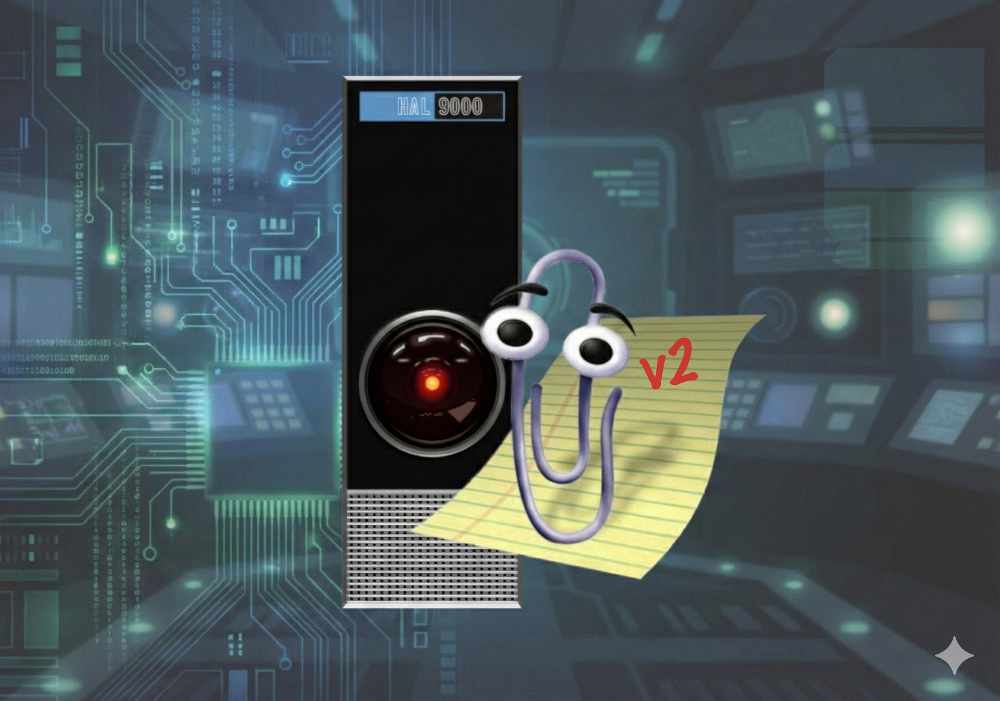

# Bienvenue !

{}
**Version 2.** Ce site présente la nouvelle version du cours, dont les cinq
modules sont maintenant publiés. Le contenu est mis à jour en continu, comme
l'explique la [présentation du cours](docs/10-présentation/#un-cours-exhaustif-et-à-jour).
La version 1 du cours reste accessible à
[cjauvin.github.io/inf1901-teluq](https://cjauvin.github.io/inf1901-teluq/).
{}

Bienvenue dans le cours **INF 1901 Initiation à l'intelligence artificielle :
concepts et réflexions**. En quelques années, l'intelligence artificielle (IA) est passée
des laboratoires à la vie de tous les jours. Ce cours vous propose de comprendre comment
fonctionnent ces systèmes, d'où ils viennent, et quels problèmes ils posent.

Il suit l'histoire de l'IA en cinq modules.

1. [Aux origines : l'intelligence artificielle symbolique](docs/module1) : faire
   raisonner une machine avec des règles et des symboles, de Turing aux systèmes
   experts.
2. [Apprentissage automatique](docs/module2) : apprendre à partir de données plutôt
   que de règles écrites à la main.
3. [Réseaux de neurones et apprentissage profond](docs/module3) : du neurone
   artificiel au Transformer.
4. [IA générative et grands modèles de langage](docs/module4) : des modèles qui
   produisent du texte, des images et du code, jusqu'aux assistants et aux agents.
5. [L'IA dans le monde](docs/module5) : les questions philosophiques, éthiques,
   sociales et politiques que pose l'IA.

Aucune expérience préalable en IA, en programmation ou en mathématiques avancées n'est
requise, seulement de la curiosité. Les mécanismes sont expliqués par des exemples
concrets, des figures et une trentaine d'applications interactives à manipuler dans votre
navigateur, et chaque [travail noté](docs/40-travaux-notés) vous fait construire ou
utiliser l'un d'eux, dans un tableur ou avec un assistant d'IA réel.

Le cours est volumineux, parce qu'il vise à couvrir le domaine le plus largement possible
et à suivre son actualité, comme l'explique la
[présentation du cours](docs/10-présentation/#un-cours-exhaustif-et-à-jour). Les
objectifs de chaque module en indiquent l'essentiel, et le cours entier peut aussi être
[téléchargé en livre](docs/15-telecharger), en PDF ou en EPUB. La
[feuille de route](docs/45-feuille-de-route) donne le calendrier des activités, et le
[serveur Discord](docs/80-discord) du cours vous permet de poser vos questions et de
discuter des idées du cours.

Au plaisir de vous guider dans cette initiation à l'intelligence artificielle, et bon
succès dans vos apprentissages !
